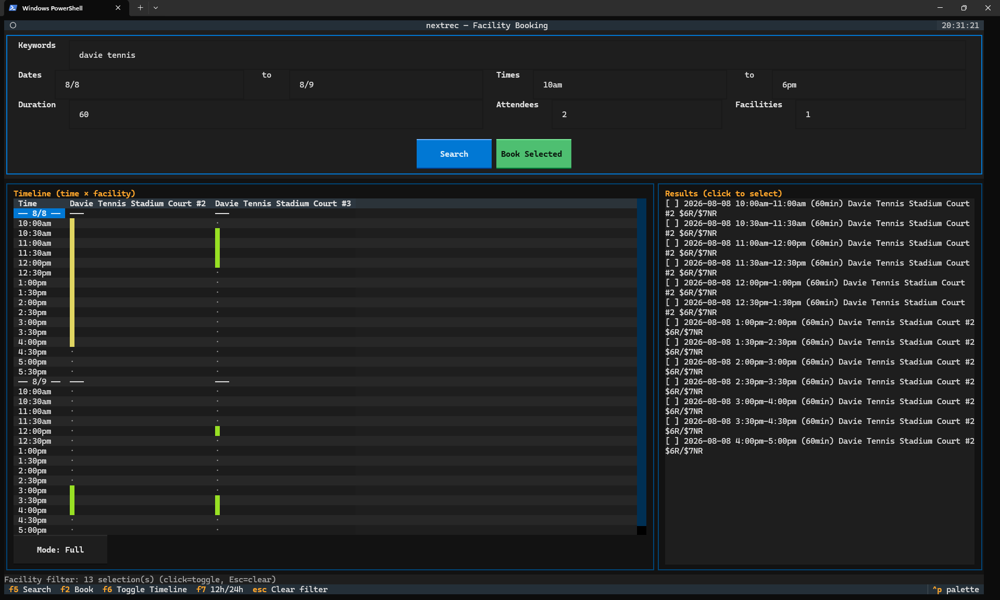

# nextrec

CLI to locate and book facility reservations on Oakland, CA's Parks and Rec site.



## Installation

```sh
git clone <repo>
cd nextrec
python -m venv .venv
.venv\Scripts\Activate.ps1   # or source .venv/bin/activate on Linux
pip install -e ".[dev]"
```

(Not yet published to PyPI — install from source as above.)

### Developer setup

Same as installation above.

## Quick Start

```sh
nextrec tui
```

Help available with:
```sh
nextrec --help
nextrec tui --help
```

## Commands

| Command | Description |
|---------|-------------|
| `book` | Search facilities and optionally book the first available slot |
| `auth` | Open headed browser for manual login and save session |
| `tui` | Interactive TUI for searching, filtering, selecting, and booking slots |
| `generate-config` | Generate a constraints config file for use with `book --config` |
| `debug-browse` | Open headed browser, interact freely, then analyze captured network traffic |

Use `nextrec <command> --help` for full option details.


## Booking and checkout

When you book (Book Selected in the TUI, or `book` without `--dry-run`), nextrec adds each selected slot to your PerfectMind cart in a hidden browser. It picks you as the participant and chooses the fee, then opens **one** browser tab on the cart so you can check out.

- **Fee:** resident by default. Choose non-resident with `--pricing non-resident`, with `pricing: non-resident` in a config file, or with the **Fee** button in the TUI.
- **Fallback:** if a slot can't be added automatically (for example, no matching fee or an unexpected page), nextrec opens that slot's booking page in its own tab so you can click Add to Cart yourself. The status line names how many slots need this.
- Payment is always left to you.
